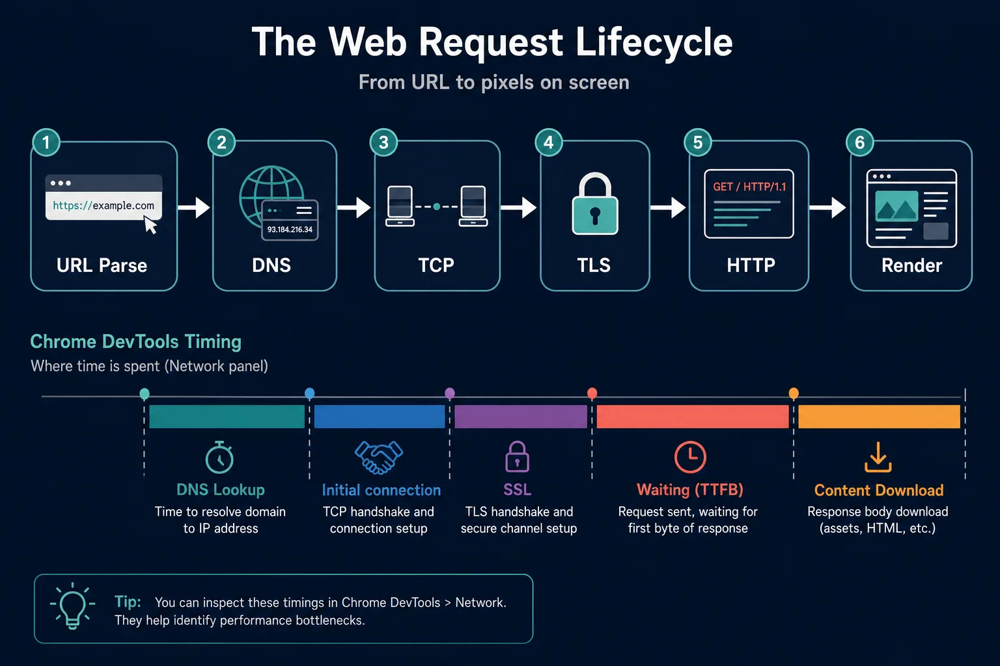
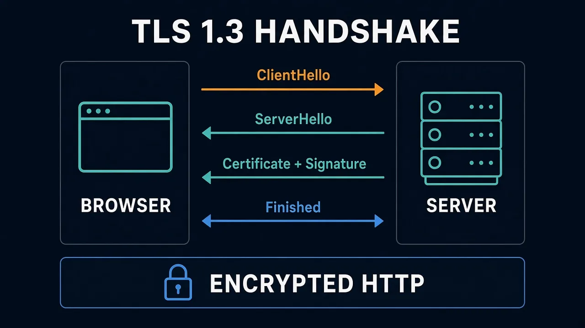
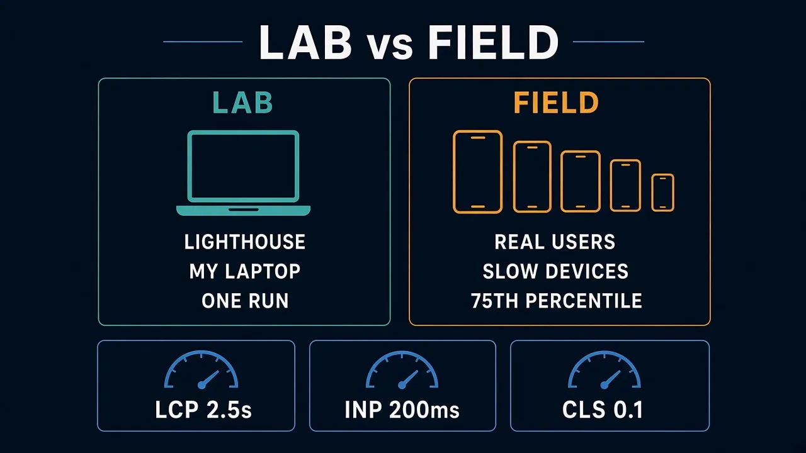
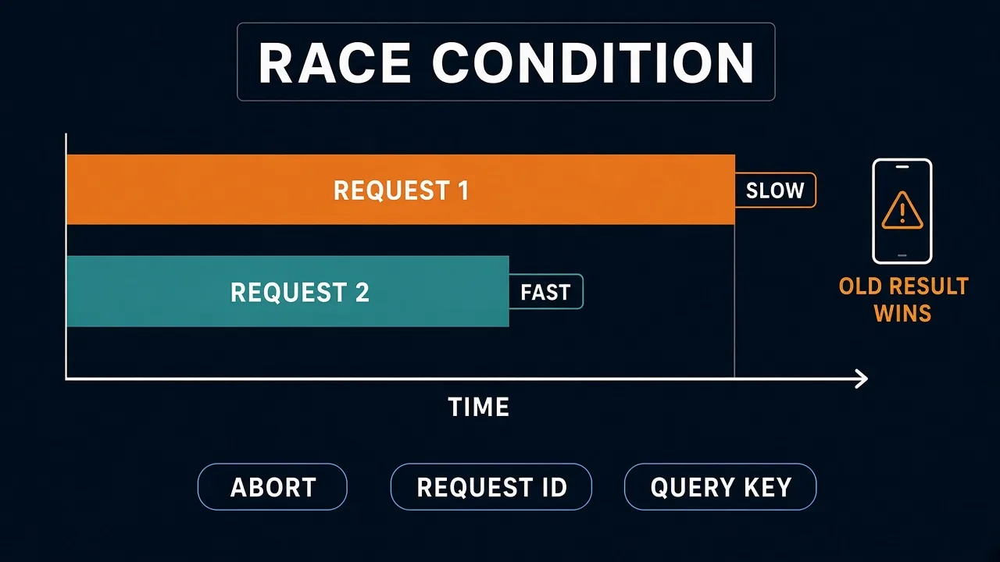
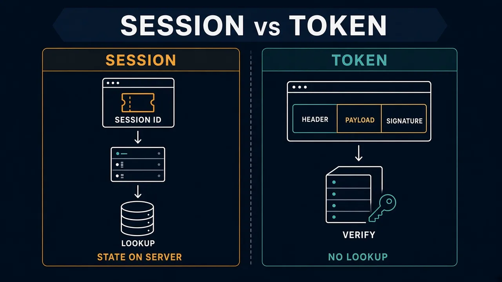



> 어제 프론트엔드 포지션 면접을 봤다. 분위기는 나쁘지 않았는데, 복기해 보니 기술 질문 8개에서 답이 틀리거나 중간에 끊겼다. 대부분 이 블로그에 이미 써 둔 내용이었다. 글로 쓴 것과 말로 꺼낼 수 있는 것은 달랐다. 질문과 그때 한 답, 다시 답한다면 할 말을 적는다. 회사와 면접관이 드러나는 내용은 뺐다.

---

## 막힌 질문 한눈에

| 질문 | 그때 한 답 | 빠진 것 |
| --- | --- | --- |
| 주소를 입력하면 화면이 뜰 때까지 | HTML을 받고 CSS·JS를 불러와 렌더링 | DNS, TCP, TLS와 렌더링 파이프라인 |
| Vue 라이프사이클 | created → fetch → mounted | 업데이트·해제 단계, Vue와 Nuxt 훅의 구분 |
| SSR과 CSR의 차이 | SEO 때문에 SSR을 쓴다 | 첫 화면 속도, 하이드레이션, 서버 비용 |
| "앱이 느려요" 문의 | Lighthouse를 본다 | 지표 세 개의 이름, 로컬과 실사용자의 차이 |
| 캐시 | 빌드해도 HTML은 그대로다 | 이름만 그대로다. 내용은 바뀐다 |
| 늦게 온 응답이 최신 결과를 덮어쓴다 | `Promise.all`로 다 기다려서 비교 | 요청 취소, 요청 번호, 중복 제출 방어 |
| JWT는 사용자를 어떻게 아나 | Redis에 토큰과 회원을 매핑 | 서명 검증. 내 답은 세션 방식이었다 |
| 컴파운드 컴포넌트 | 공통 컴포넌트를 패키지로 모았다 | 질문과 다른 답이었다 |

---

## 1. 주소를 입력하면 화면이 뜰 때까지

**질문.** 사용자가 브라우저에 주소를 입력하면 화면이 그려질 때까지 브라우저가 내부적으로 무엇을 하는가. 프레임워크는 빼고 설명해 달라.

**그때 한 답.** HTML을 불러오고, 거기 연결된 CSS와 JS를 받는다. React라면 루트 DOM에 JS가 내용을 넣으면서 렌더링되고, SSR이라면 어느 정도 채워진 HTML이 온다.

HTML을 받기 전 단계를 통째로 건너뛰었고, 프레임워크를 빼 달라는 말에 React와 SSR로 답했다.

면접 직후에는 HTTPS 인증 과정을 묻는 질문이었다고 생각했다. 복기해 보니 범위가 더 넓었다. 주소 입력부터 픽셀이 찍힐 때까지 전체를 묻는 질문이고, HTTPS는 그중 한 단계다.

### 다시 답한다면

1. **URL 파싱.** 스킴, 호스트, 포트를 나눈다. `https`면 443번 포트다.
2. **DNS 조회.** 브라우저 캐시, OS 캐시, 리졸버 순으로 찾고, 없으면 루트 → TLD → 권한 네임서버를 거쳐 IP를 얻는다.
3. **TCP 연결.** 3-way handshake로 연결을 만든다. HTTP/3이면 TCP 대신 QUIC을 쓴다.
4. **TLS 핸드셰이크.** 서버 인증서를 검증하고, 암호화에 쓸 대칭키를 정한다.
5. **HTTP 요청과 응답.** `GET /`을 보내고 상태 코드, 헤더, HTML 본문을 받는다.
6. **파싱.** HTML로 DOM을, CSS로 CSSOM을 만든다. CSS는 렌더링을 막고, `defer`나 `async`가 없는 `<script>`는 HTML 파싱을 멈춘다.
7. **렌더링.** DOM과 CSSOM을 합쳐 Render Tree를 만들고 Layout → Paint → Composite 순으로 화면에 그린다.
8. **JS 실행.** 스크립트가 DOM을 바꾸면 6~7이 다시 돈다. CSR은 화면의 대부분이 이 단계에서 그려진다.

{: #magnific width="1536" height="1024"}

### HTTPS 단계만 따로

여기가 내가 가장 흐릿했던 곳이다.

인증서는 "이 공개키의 주인이 이 도메인이다"라는 것을 인증기관(CA)이 서명한 문서다. 브라우저는 네 가지를 확인한다.

1. 인증서 체인이 브라우저와 OS가 신뢰하는 루트 CA까지 이어지는가
2. 인증서에 적힌 도메인(SAN)이 접속한 호스트와 같은가
3. 유효기간 안인가
4. 폐기된 인증서가 아닌가

하나라도 실패하면 "연결이 비공개로 설정되어 있지 않습니다" 경고가 뜬다.

TLS 1.3의 흐름은 한 번의 왕복이다.

{: #magnific width="1280" height="720"}

```text
클라이언트                                   서버
   │ ── ClientHello ──────────────────────▶ │  지원 암호 방식, 키 교환 값, 접속할 도메인(SNI)
   │ ◀─ ServerHello ────────────────────── │  선택한 암호 방식, 키 교환 값
   │ ◀─ Certificate, CertificateVerify ─── │  인증서, 개인키로 만든 서명
   │ ◀─ Finished ───────────────────────── │
   │ ── Finished ─────────────────────────▶ │
   │ ══ 대칭키로 암호화한 HTTP ═══════════ │
```

- 양쪽이 키 교환 값(ECDHE)을 주고받아 같은 대칭키를 각자 계산한다. 대칭키 자체는 네트워크에 실리지 않는다.
- 서버의 개인키는 핸드셰이크 내용에 서명하는 데 쓴다. 인증서의 공개키로 그 서명이 검증되면 상대가 인증서의 주인이다.
- 이후의 HTTP 데이터는 대칭키로 암호화한다. 비대칭키보다 훨씬 빠르기 때문이다.

"클라이언트가 대칭키를 서버 공개키로 암호화해서 보낸다"는 설명은 TLS 1.2의 RSA 키 교환이고, TLS 1.3에서는 없어졌다.

각 단계의 상세는 [www.google.com 입력하면 일어나는 일](/front/2026/06/16/browser-request-flow/)에 있다. 다섯 달 전에 내가 쓴 글이다.

---

## 2. Vue 라이프사이클

**질문.** Vue의 라이프사이클을 순서대로, 단계별 특성과 함께 설명해 달라.

**그때 한 답.** created, fetch, mounted 순이다. created와 fetch는 서버에서 호출되고, mounted는 DOM이 그려진 뒤 브라우저에서 호출된다. 그 뒤는 기억나지 않는다.

Vue의 훅과 Nuxt의 훅을 섞어 말했고, 마운트 이후를 통째로 빠뜨렸다.

### 다시 답한다면

네 단계로 나누고, 단계마다 직전과 직후 훅이 있다고 말한다.

| 단계 | Vue 2 (Options API) | Vue 3 (Composition API) | 이 시점에 하는 일 |
| --- | --- | --- | --- |
| 생성 | `beforeCreate`, `created` | `setup()` | 반응형 데이터가 준비된다. DOM은 아직 없다 |
| 마운트 | `beforeMount`, `mounted` | `onBeforeMount`, `onMounted` | DOM이 만들어진다. `mounted`부터 DOM과 `ref`에 접근한다 |
| 업데이트 | `beforeUpdate`, `updated` | `onBeforeUpdate`, `onUpdated` | 반응형 데이터가 바뀌어 다시 그릴 때 호출된다 |
| 해제 | `beforeDestroy`, `destroyed` | `onBeforeUnmount`, `onUnmounted` | 타이머, 이벤트 리스너, 구독을 정리한다 |

- Vue 3의 Options API에서는 해제 훅 이름이 `beforeUnmount`, `unmounted`로 바뀌었다.
- `<keep-alive>` 안의 컴포넌트는 해제되지 않고 `activated`, `deactivated`가 호출된다.

### SSR에서 달라지는 것

서버에서는 생성 단계까지만 실행된다. 마운트부터는 브라우저에서만 실행된다.

"created는 서버에서 호출된다"는 내 답은 절반만 맞다. 첫 요청에서 `created`는 서버에서 한 번, 브라우저에서 하이드레이션할 때 한 번 더 실행된다. 그래서 `window`나 `document`를 쓰는 코드는 `mounted`에 둔다.

### Nuxt 2의 훅은 따로다

`asyncData`와 `fetch`는 Vue가 아니라 Nuxt의 훅이다.

| | `asyncData` | `fetch` (2.12 이상) |
| --- | --- | --- |
| 쓸 수 있는 곳 | 페이지 컴포넌트 | 모든 컴포넌트 |
| 호출 시점 | 컴포넌트 생성 전 | `created` 뒤 |
| `this` | 없다 | 있다 |
| 결과 | 반환값이 `data`에 합쳐진다 | `this`에 직접 넣는다 |

둘 다 첫 요청에서는 서버에서, 페이지를 이동할 때는 브라우저에서 실행된다. 첫 요청의 순서는 이렇다.

```text
서버:      middleware → asyncData → beforeCreate → created → fetch → HTML 전송
브라우저:  beforeCreate → created → beforeMount → mounted
```

---

## 3. SSR과 CSR의 차이

**질문.** SSR과 CSR은 무엇이 다른가.

**그때 한 답.** SSR은 SEO를 위해 쓴다. CSR은 HTML에 루트 `div` 하나뿐이라 봇이 페이지 내용을 알 수 없다.

틀린 말은 아닌데 SEO만 말했다. 면접관도 "SEO 관점에 집중해서 설명했다"고 짚었다.

### 다시 답한다면

차이는 HTML을 어디서 만드느냐이고, 그 결과가 네 군데에 나타난다.

| | CSR | SSR |
| --- | --- | --- |
| 첫 응답 | 빈 루트와 JS 번들 주소 | 내용이 채워진 HTML |
| 첫 화면 | JS를 받아 실행한 뒤에 보인다 | HTML이 도착하면 보인다. 하이드레이션이 끝나야 눌린다 |
| 서버 | 정적 파일만 내려 준다 | 요청마다 렌더링할 서버가 필요하다 |
| 검색·공유 미리보기 | 불리하다 | 유리하다 |

SSR은 서버가 렌더링하는 시간만큼 첫 바이트(TTFB)가 늦어질 수 있고, 화면은 보이는데 눌리지 않는 구간이 생긴다. CSR은 번들이 클수록, 기기가 느릴수록 첫 화면이 늦다.

내가 SSR을 걷어낸 이유는 이 표로 설명된다. 웹뷰 안에서만 열리는 앱이라 검색 노출이 필요 없었고, SSR 전용 기능을 쓰는 곳도 없었다. 남는 것은 렌더링 서버 비용뿐이었다. 이 부분은 면접에서도 그대로 말했고 통했다.

---

## 4. "앱이 느려요"라는 문의가 오면

**질문.** 고객센터로 "서비스가 느리다"는 문의가 들어왔다. 무엇을 확인하겠는가.

**그때 한 답.** Lighthouse로 웹 바이탈을 본다. 지표는 세 가지인데 이름이 기억나지 않는다. 로컬에서 빠르게 나온다면 백엔드 API를 확인한다.

### 지표 세 개

| 지표 | 재는 것 | 좋음 기준 |
| --- | --- | --- |
| LCP (Largest Contentful Paint) | 가장 큰 콘텐츠가 보이기까지의 시간 | 2.5초 이하 |
| INP (Interaction to Next Paint) | 클릭이나 입력 뒤 화면이 반응하기까지의 시간 | 200ms 이하 |
| CLS (Cumulative Layout Shift) | 로딩 중 레이아웃이 밀린 정도 | 0.1 이하 |

기준은 실사용자의 75번째 백분위수로 본다. INP는 2024년 3월에 FID를 대체했다. Lighthouse는 사용자 입력이 없어서 INP를 재지 못하고, 대신 TBT(Total Blocking Time)를 보여 준다.

### "로컬에서는 빠르다"는 꼬리 질문

이 질문의 답은 백엔드가 아니라 **측정 환경의 차이**였다.

{: #magnific width="1280" height="720"}

Lighthouse는 내 PC와 내 네트워크에서 한 번 잰 실험실 데이터다. 사용자가 느리다고 말하는 것은 현장 데이터다. 로컬에서 빠르다면 내 환경과 사용자의 환경이 어디서 다른지 찾아야 한다.

1. **문의를 좁힌다.** 어느 화면인지, 언제인지, 기기와 OS와 앱 버전이 무엇인지 확인한다.
2. **실사용자 데이터를 본다.** `web-vitals` 라이브러리나 Sentry Performance로 모은 값을 페이지, 기기, 네트워크별로 나눠 p75와 p95를 본다. 평균은 느린 사용자를 가린다.
3. **조건을 맞춰 재현한다.** DevTools에서 CPU를 4~6배 느리게, 네트워크를 Slow 4G로 두고 캐시를 비운다.
4. **구간을 나눈다.** Network 탭에서 TTFB가 길면 서버와 API, 다운로드가 길면 번들과 이미지 크기다. Performance 탭에 Long Task가 많으면 JS 실행이다.
5. **고친 뒤 같은 지표로 다시 잰다.**

API를 확인하겠다는 내 답은 4번의 일부다.

---

## 5. 캐시: HTML은 그대로인가

**질문.** 빌드하면 HTML 파일은 그대로이고 JS와 CSS만 바뀐다고 했는데, HTML이 그대로인 것이 맞는가.

**그때 한 답.** `index.html` 파일이 하나라는 뜻이었는데 잘못 설명했다.

그 자리에서 고치긴 했지만 처음 설명에 표현이 두 군데 틀렸다.

- `index.html`은 **이름**이 그대로다. 내용은 빌드마다 바뀐다. 안에 적힌 JS, CSS 파일 이름이 바뀌기 때문이다.
- 파일 이름에 붙는 것은 난수가 아니라 **콘텐츠 해시**다. 내용이 같으면 같은 값이 나오므로, 바뀌지 않은 파일은 다음 배포 뒤에도 캐시가 유지된다.

| 파일 | 헤더 | 이유 |
| --- | --- | --- |
| `index.html` | `Cache-Control: no-cache` | 이름이 고정이다. 쓸 때마다 서버에 바뀌었는지 묻는다 |
| `app.3f9a1c.js` | `Cache-Control: public, max-age=31536000, immutable` | 내용이 바뀌면 이름이 바뀐다. 같은 이름은 영원히 같은 내용이다 |

`no-cache`는 저장하지 말라는 뜻이 아니다. 저장은 하되 쓰기 전에 서버에 확인하고, 그대로면 본문 없이 304를 받는다. 저장 자체를 금지하는 것은 `no-store`다.

### 같은 이름의 이미지를 바꿨을 때

1. **파일 이름에 해시를 넣는다.** 가장 확실하다.
2. **쿼리스트링을 붙인다(`?v=2`).** 브라우저는 다른 주소로 본다. 다만 CDN이 쿼리스트링을 캐시 키에 넣도록 설정돼 있어야 한다. 아니면 CDN이 예전 이미지를 그대로 준다.
3. **CDN 캐시를 무효화한다.** CDN에 있는 것만 지워진다. 이미 사용자 브라우저에 저장된 것은 만료될 때까지 남는다.

---

## 6. 늦게 온 응답이 최신 결과를 덮어쓴다

**질문.** API를 여러 번 호출하면 응답이 오는 순서는 정해져 있지 않다. 이전 요청의 응답이 늦게 도착해 최신 결과를 덮어쓰는 문제를 어떻게 막는가. 백엔드가 멱등성을 보장하지 않는다는 전제로, 프론트엔드에서.

**그때 한 답.** `Promise.all`로 모든 API가 끝날 때까지 기다린 다음, 비교해서 최신 값을 가진 응답 하나만 쓴다.

면접관이 바로 되물었다. 그렇게 하면 서비스가 지연되지 않느냐고. 이 면접에서 가장 아쉬운 답이다.

{: #magnific width="1280" height="720"}

### 왜 틀렸나

- 가장 느린 요청이 끝날 때까지 화면이 멈춘다.
- 사용자는 계속 입력한다. "모든 요청"이 몇 개인지 미리 알 수 없다.
- 하나가 실패하면 전체가 실패한다.
- 응답 안에는 어느 것이 최신인지 적혀 있지 않다. 최신은 **내가 마지막으로 보낸 요청**이고, 그것은 보내는 쪽이 이미 알고 있다.

질문에는 두 가지 문제가 섞여 있었다. 조회 응답의 순서가 뒤집히는 것과, 같은 요청이 두 번 나가는 것이다.

### 조회: 마지막 요청만 반영한다

**이전 요청을 취소한다.**

```ts
let controller: AbortController | null = null;

async function search(keyword: string): Promise<SearchResult[] | null> {
  controller?.abort();
  controller = new AbortController();

  try {
    const res = await fetch(`/api/search?q=${encodeURIComponent(keyword)}`, {
      signal: controller.signal,
    });
    if (!res.ok) throw new Error(`HTTP ${res.status}`);
    return (await res.json()) as SearchResult[];
  } catch (error) {
    if (error instanceof DOMException && error.name === "AbortError") return null;
    throw error;
  }
}
```

**취소할 수 없으면 요청 번호를 비교한다.**

```ts
let latestRequestId = 0;

async function load(keyword: string): Promise<void> {
  const requestId = ++latestRequestId;
  const data = await fetchResults(keyword);

  if (requestId !== latestRequestId) return; // 나보다 늦게 보낸 요청이 있으면 버린다
  render(data);
}
```

**React Query는 쿼리 키가 이 일을 한다.**

```tsx
const { data } = useQuery({
  queryKey: ["search", keyword],
  queryFn: ({ signal }) => fetchResults(keyword, signal),
});
```

응답은 자기 키의 캐시에만 들어간다. 화면은 현재 키만 구독하므로, 예전 키의 응답이 늦게 와도 화면을 덮어쓰지 못한다. `signal`을 `fetch`에 넘기면 더는 쓰이지 않는 요청을 취소까지 한다. 실무에서 React Query를 쓰고 있었는데 이 답을 못 했다.

**Vue는 `watch`의 정리 함수를 쓴다.**

```ts
watch(keyword, async (value, _prev, onCleanup) => {
  const controller = new AbortController();
  onCleanup(() => controller.abort());

  try {
    results.value = await fetchResults(value, controller.signal);
  } catch (error) {
    if (!controller.signal.aborted) throw error;
  }
});
```

디바운스는 요청 수를 줄일 뿐이다. 남은 요청끼리의 순서는 보장하지 않는다.

### 제출: 같은 요청이 두 번 나간다

```tsx
const submittingRef = useRef(false);
const [isSubmitting, setIsSubmitting] = useState(false);

const handleSubmit = async (): Promise<void> => {
  if (submittingRef.current) return;

  submittingRef.current = true;
  setIsSubmitting(true);
  try {
    await createOrder(payload);
  } finally {
    submittingRef.current = false;
    setIsSubmitting(false);
  }
};
```

`disabled`에 쓰는 state는 다음 렌더링에 반영된다. 그 전에 들어온 두 번째 클릭은 `ref`로 막는다.

프론트엔드의 방어는 여기까지다. 타임아웃 뒤의 재시도, 여러 탭, 네트워크 재전송은 버튼으로 막지 못한다. 면접에서 이름이 생각나지 않았던 헤더는 `Idempotency-Key`다. 시도 한 번에 키 하나를 만들고, 재시도할 때 같은 키를 다시 보낸다. 서버는 같은 키에 같은 결과를 돌려준다.

```ts
const idempotencyKey = crypto.randomUUID(); // 재시도해도 이 값을 그대로 쓴다

await fetch("/api/orders", {
  method: "POST",
  headers: { "Content-Type": "application/json", "Idempotency-Key": idempotencyKey },
  body: JSON.stringify(payload),
});
```

서버 쪽 구현은 [결제 버튼을 잠가도 두 번 빠진다](/backend/2026/10/22/idempotent-payment/)에 썼다.

---

## 7. JWT는 사용자를 어떻게 알아보나

**질문.** 토큰이 들어오면 서버는 이 토큰이 누구의 것인지 어떻게 아는가.

**그때 한 답.** Redis에 회원과 토큰을 매핑해 둔다. 만료되면 리프레시 토큰으로 바꿔 준다.

면접관이 짚었다. 서버에 저장해 두고 찾아보는 것은 세션 방식이라고.

### 다시 답한다면

JWT는 `헤더.페이로드.서명` 세 부분이다. 서버는 발급할 때 헤더와 페이로드를 비밀키로 서명한다. 요청이 오면 서명을 검증하고, 만료 시각(`exp`)을 확인한 뒤, 페이로드의 `sub`에서 사용자 ID를 꺼낸다. 저장소를 조회하지 않는다.

{: #magnific width="1280" height="720"}

| | 세션 | JWT 액세스 토큰 |
| --- | --- | --- |
| 클라이언트가 가진 것 | 뜻이 없는 세션 ID | 사용자 정보와 서명 |
| 서버가 확인하는 방법 | 저장소에서 ID를 조회 | 서명을 검증 |
| 서버의 상태 | 있다 | 없다 |
| 즉시 폐기 | 저장소에서 지우면 된다 | 만료 전에는 어렵다 |

페이로드는 암호화가 아니라 Base64URL 인코딩이다. 누구나 열어 볼 수 있다. 서명이 막는 것은 읽기가 아니라 **고치기**다. 그래서 비밀번호나 주민번호 같은 값은 넣지 않는다.

폐기가 어렵다는 약점 때문에 토큰을 둘로 나눈다. 액세스 토큰은 수명을 짧게 하고, 리프레시 토큰은 서버에 상태를 둔다. 내가 말한 "Redis에 저장한 토큰"이 리프레시 토큰이라면 맞는 구조다. 그렇게 말했어야 했다.

> 액세스 토큰은 서명으로 검증해서 저장소를 보지 않습니다. 대신 즉시 폐기가 안 되기 때문에 수명을 짧게 두고, 리프레시 토큰만 서버에 저장해서 로그아웃이나 탈취 때 폐기합니다.

액세스 토큰의 차단 목록을 Redis에 두는 방법도 있다. 그러면 요청마다 조회가 생기고, 저장소를 보지 않는다는 이점이 그만큼 줄어든다.

이 구조를 직접 구현한 기록은 [로그인이 만료된 순간 요청 5개](/backend/2026/10/22/wristband-refresh-token/)에 있다.

---

## 8. 컴파운드 컴포넌트

**질문.** Context API를 썼다면, 컴포넌트를 만들 때 컴파운드 패턴을 써 봤는가.

**그때 한 답.** 공통 컴포넌트는 모노레포의 패키지 폴더에 모아 두고 가져다 썼다.

컴포넌트를 공통화했다는 이야기였고, 질문은 컴포넌트의 구조였다.

### 다시 답한다면

컴파운드 패턴은 부모가 상태를 갖고, 자식들이 Context로 그 상태를 공유하는 구조다. 쓰는 쪽은 props를 길게 넘기는 대신 자식을 조합한다. `<select>`와 `<option>`의 관계와 같다.

```tsx
interface TabsContextValue {
  activeId: string;
  select: (id: string) => void;
}

interface TabsProps {
  defaultId: string;
  children: ReactNode;
}

interface TabItemProps {
  id: string;
  children: ReactNode;
}

const TabsContext = createContext<TabsContextValue | null>(null);

const useTabs = (): TabsContextValue => {
  const context = useContext(TabsContext);
  if (!context) throw new Error("Tabs.Tab과 Tabs.Panel은 <Tabs> 안에서만 쓸 수 있습니다.");
  return context;
};

const TabsRoot = ({ defaultId, children }: TabsProps) => {
  const [activeId, setActiveId] = useState(defaultId);
  const value = useMemo(() => ({ activeId, select: setActiveId }), [activeId]);

  return <TabsContext.Provider value={value}>{children}</TabsContext.Provider>;
};

const Tab = ({ id, children }: TabItemProps) => {
  const { activeId, select } = useTabs();

  return (
    <button role="tab" aria-selected={activeId === id} onClick={() => select(id)}>
      {children}
    </button>
  );
};

const Panel = ({ id, children }: TabItemProps) => {
  const { activeId } = useTabs();
  if (activeId !== id) return null;

  return <div role="tabpanel">{children}</div>;
};

export const Tabs = Object.assign(TabsRoot, { Tab, Panel });
```

```tsx
<Tabs defaultId="charge">
  <Tabs.Tab id="charge">충전</Tabs.Tab>
  <Tabs.Tab id="history">내역</Tabs.Tab>

  <Tabs.Panel id="charge">충전 화면</Tabs.Panel>
  <Tabs.Panel id="history">내역 화면</Tabs.Panel>
</Tabs>
```

- 탭 사이에 배지나 구분선을 넣고 싶을 때 `Tabs`의 props를 늘리지 않아도 된다.
- 상태가 `Tabs` 안에 갇혀 있어 바깥으로 새지 않는다.
- 자식을 `<Tabs>` 밖에서 쓰면 동작하지 않는다. 그래서 `useTabs`에서 에러를 던진다.

---

## 기술 밖에서 놓친 것

- **숫자가 흔들렸다.** 이력서에 적은 수치와 말로 한 수치가 달랐고, 프로젝트 개수도 답변마다 달랐다. 이력서에 쓴 숫자는 계산 근거까지 한 줄로 말할 수 있어야 한다.
- **지원한 팀의 서비스를 써 보지 않고 갔다.** 소속 회사와 고객사도 구분하지 못했다. 앱을 한 번 설치해 보는 데 10분이면 됐다.
- **"기억이 안 난다"로 끝낸 답이 세 번이었다.** 이름이 생각나지 않으면 무엇을 재는 지표인지, 왜 필요한지부터 말했어야 했다.

---

## 다음 면접 전에 볼 것

1. 주소 입력부터 화면까지 1분 안에 말한다. DNS → TCP → TLS → HTTP → DOM/CSSOM → Render Tree → Layout → Paint.
2. TLS는 인증서 검증, 키 교환, 대칭키 암호화 세 가지로 말한다.
3. Vue 라이프사이클은 생성, 마운트, 업데이트, 해제 네 단계다. `asyncData`와 `fetch`는 Nuxt의 훅이다.
4. LCP 2.5초, INP 200ms, CLS 0.1.
5. 로컬에서 빠르면 실사용자 데이터를 본다.
6. 응답 순서가 뒤집히면 취소하거나 요청 번호를 비교한다. `Promise.all`이 아니다.
7. JWT는 조회가 아니라 서명 검증이다. 리프레시 토큰만 서버에 저장한다.
8. 컴파운드 패턴은 부모의 상태를 자식이 Context로 공유하는 구조다.

---

## 참고

- [[FRONT] www.google.com 입력하면 일어나는 일 — DNS부터 렌더링까지](/front/2026/06/16/browser-request-flow/)
- [[FRONT] 브라우저 렌더링 과정](/front/2024/12/26/lender/)
- [[React] React Query 사용법](/reactguide/2025/08/01/reactQuery/)
- [[BACKEND] 결제 버튼을 잠가도 두 번 빠진다](/backend/2026/10/22/idempotent-payment/)
- [[BACKEND] 로그인이 만료된 순간 요청 5개](/backend/2026/10/22/wristband-refresh-token/)
- [web.dev — Web Vitals](https://web.dev/articles/vitals)
- [Vue — 라이프사이클 훅](https://ko.vuejs.org/guide/essentials/lifecycle)
- [Nuxt 2 — Lifecycle](https://v2.nuxt.com/docs/concepts/nuxt-lifecycle/)
- [TanStack Query — Query Cancellation](https://tanstack.com/query/latest/docs/framework/react/guides/query-cancellation)
- [RFC 8446 — TLS 1.3](https://datatracker.ietf.org/doc/html/rfc8446)
