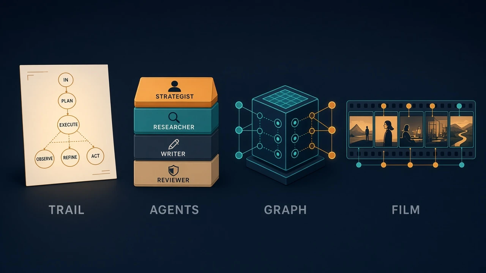
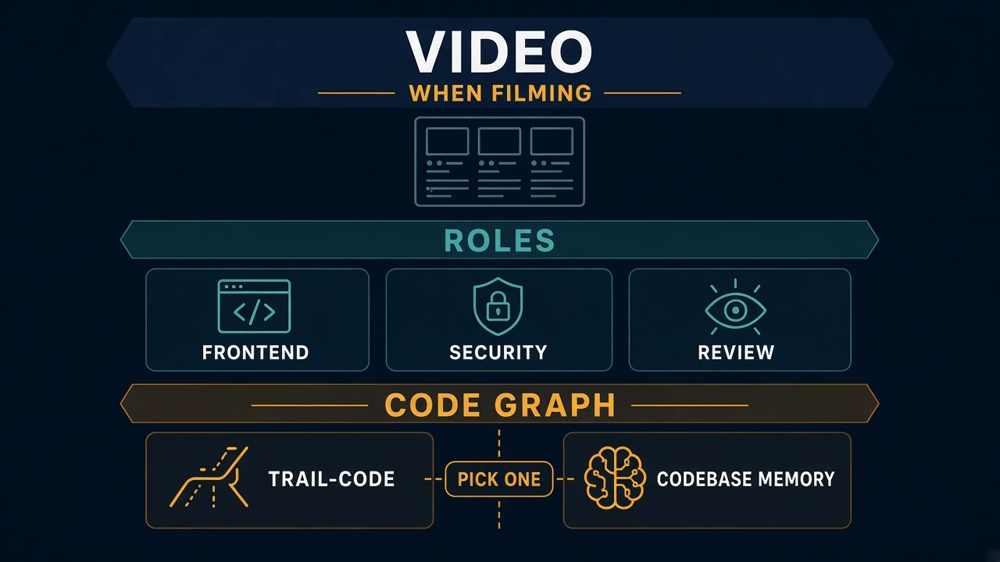
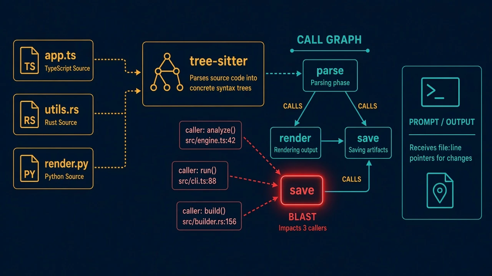
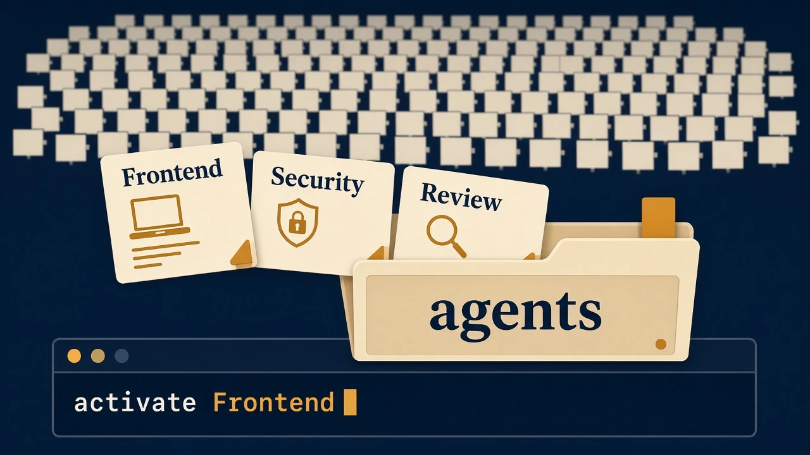
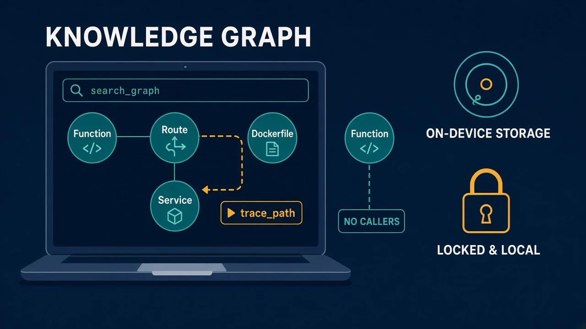
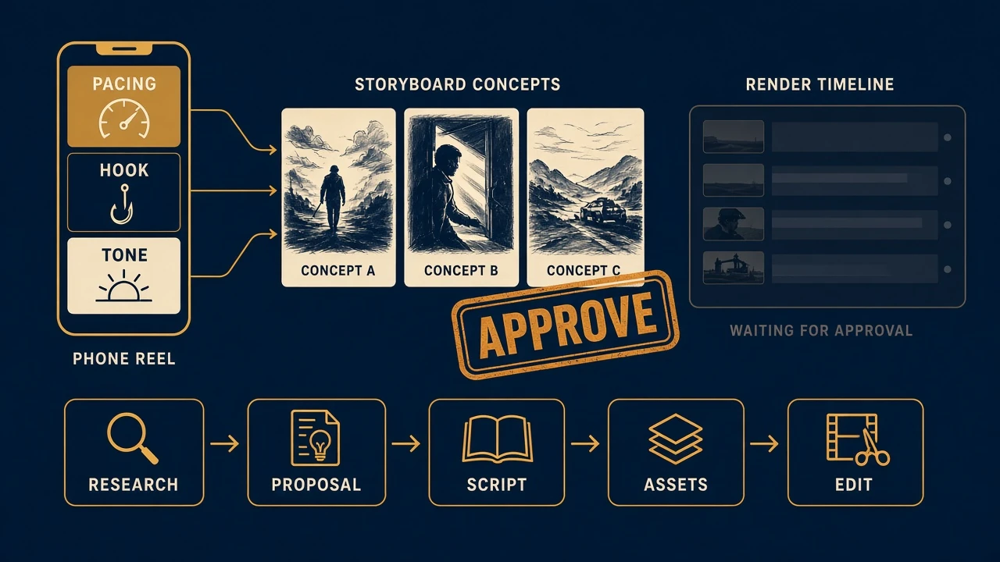



> Claude Code 옆에 붙인다는 오픈소스 네 가지를, 2026년 11월 저장소와 공식 문서 기준으로 읽어 봤다. 이름은 한 줄에 놓여 있지만 하는 일은 세 층으로 갈린다. 코드 이해 도구 둘, 역할 프롬프트 묶음 하나, 영상 제작 파이프라인 하나다.

{: #magnific width="1280" height="720"}

아래 도해는 제품을 찍은 화면이 아니다. 각 도구가 맡는 자리를 그림으로 옮긴 것이다. 스타 수와 설치 후 체감 속도는 재지 않았다.

---

## 한눈에

| 도구 | 저장소 | 하는 일 | 코드가 머무는 곳 | 라이선스 |
| --- | --- | --- | --- | --- |
| Graft → Trail-code | [trailhq/Trail-Code](https://github.com/trailhq/Trail-Code) | 호출 그래프를 만들어 프롬프트에 붙이고, 수정 직후 영향 범위를 보여 줌 | 내 컴퓨터. 그래프 생성에 모델 불필요 | MIT |
| Agency Agents | [msitarzewski/agency-agents](https://github.com/msitarzewski/agency-agents) | 분야별 전문가 페르소나를 에이전트로 설치 | 마크다운. 코드 분석 엔진 없음 | MIT |
| Codebase Memory MCP | [DeusData/codebase-memory-mcp](https://github.com/DeusData/codebase-memory-mcp) | 코드를 로컬 지식 그래프로 저장하고 검색·추적 | 내 컴퓨터. API 키 불필요 | MIT |
| OpenMontage | [calesthio/OpenMontage](https://github.com/calesthio/OpenMontage) | 조사부터 편집·렌더까지 영상 제작 | 오케스트레이션은 로컬. 생성 API는 선택 | AGPL-3.0 |

매일 코딩에 붙이는 것은 앞의 셋이다. OpenMontage는 영상을 만들 때만 켠다.

- **Trail-code**는 에이전트가 묻기 전에 맥락을 넣는다.
- **Codebase Memory**는 에이전트가 물을 때 그래프에서 답을 찾는다.
- **Agency Agents**는 모델을 더 똑똑하게 만드는 장치가 아니다. 어떤 역할로 일할지 정한다.
- **OpenMontage**는 코딩 보조가 아니다. 참고 릴스를 분석한 기획안을 먼저 보여주고, 승인 뒤에 제작한다.

---

## 네 개는 같은 층이 아니다

{: #magnific width="1280" height="720"}

아래층은 코드 그래프다. Trail-code와 Codebase Memory가 이 칸을 같이 차지한다. 가운데는 역할이다. Agency Agents는 그래프와 겹치지 않아서 같이 둬도 된다. 위층은 영상이다. 블로그나 서비스 코드를 고치는 세션에 상시로 둘 이유가 없다.

그래프 둘을 동시에 켜면 훅이 비슷한 맥락을 두 번 넣고, “어디가 영향받나”에 대한 답도 두 시스템에서 나온다. 코딩용으로는 하나만 고른다.

---

## Trail-code, 옛 Graft

저장소 이름은 [Trail-Code](https://github.com/trailhq/Trail-Code)로 바뀌었고, 문서 주소는 아직 [graft.sharonwang.me](https://graft.sharonwang.me)다. 라이선스는 MIT. 핵심은 두 층이다.

1. **graft map.** `trail init`이 tree-sitter로 파일, 함수, 누가 누구를 호출하는지를 파싱한다. 이 층은 모델도 API 키도 네트워크도 쓰지 않는다.
2. **Learnings.** 세션에서 알아낸 사실이나 교정한 규칙을 저장한다. 코드에 대한 학습은 커밋되고, 개인 습관은 그 머신에 남는다. 첫 실행 때는 과거 Claude 세션에서 반복된 말과, 머지된 PR에서 리뷰어가 반복해서 지적한 내용을 씨앗으로 넣는다.

{: #magnific width="1280" height="720"}

Claude Code와는 훅으로 붙는다. `trail init --agents claude`를 실행하고 `.mcp.json`을 커밋한 뒤 세션을 다시 열면 된다.

```bash
trail init --agents claude
git add .claude .mcp.json .trail .gitignore .ignore
```

세션이 열리면 이런 일이 일어난다.

- 프롬프트마다 관련 노드와, 그 코드에 붙어 있던 learning이 들어온다.
- 파일을 고치면 그 심볼에 의존하는 곳, 즉 blast radius가 바로 보인다.
- 쿼리 전에 워킹 트리를 본다. 커밋하지 않은 수정도 반영한다. 이 갱신은 구조만 보고 LLM을 호출하지 않는다.
- 팀원이 연 브랜치와 같은 함수를 건드리면 충돌 가능성을 알려 준다.
- 상태 줄에 그래프 크기, learning 수, 코드가 그래프보다 앞서면 `stale` 경고가 뜬다.

그래프 파일(`graft/`)은 `node_modules`처럼 로컬 캐시라 `.gitignore`에 들어간다. 평문 요약이 필요하면 `trail build --deep`인데, 이때만 본인 API 키가 든다. 제공자는 OpenAI 호환 엔드포인트, Anthropic, LiteLLM 중에서 고른다.

손으로 영향 범위를 보고 싶을 때는 CLI로도 된다. LLM이 필요 없다.

```bash
trail map
trail callers save -d 2
trail blast --base origin/main --format markdown
```

`-d 2`가 보통 “이걸 건드리면 어디가 깨지나”의 범위다. `--depth all`은 연결된 호출을 끝까지 따라간다. `trail blast`는 diff가 닿은 줄에 의존하는 영역을 뽑는다.

언어는 24개에 Vue 단일 파일 컴포넌트가 더해진다. 정확도는 두 단계다.

- **정밀.** TypeScript / JavaScript(JSX, TSX 포함), Python, Go, Java, Kotlin, PHP, Swift, R, Vue. 스코프를 보고 파일 너머 호출과 import를 푼다.
- **넓은 추출.** Rust, C, C++, C#, Ruby, Scala, Elixir, Solidity, Dart, Clojure, Nix, Lua, Gleam, OCaml. Zig는 현재 심볼만 있고 호출 간선은 없다.

언어 서버가 PATH에 있으면 `trail build --lsp`로 정적 분석이 못 푸는 멤버 호출을 보강할 수 있다. rust-analyzer, clangd, gopls, pyright, typescript-language-server 중 설치된 것을 쓴다. 서버가 없으면 그래프는 그대로다.

목록에 없는 언어 파일은 인덱싱되지 않고 건너뛴다. 동적 디스패치, 리플렉션, 프레임워크가 문자열로 연결하는 호출은 간선이 빠진다. blast radius는 그 빈칸을 그대로 안고 간다.

MCP로 노출되는 도구는 여섯 개다. `trail_find_code`, `trail_file_api`, `trail_trace_calls`, `trail_find_all`, `trail_repo_map`, `trail_check_freshness`. Cursor나 Codex도 같은 지도를 MCP와 지침 파일로 받는다. Claude Code만 프롬프트 훅까지 깊다.

---

## Agency Agents, 역할 카드

[agency-agents](https://github.com/msitarzewski/agency-agents)는 코드 인덱서가 아니다. 에이전트 하나가 마크다운 한 장이다. 그 안에 정체성, 작업 절차, 산출물, 완료 기준이 들어 있다. 라이선스는 MIT. README는 230개가 넘는 에이전트가 엔지니어링, 보안, 디자인, 마케팅, 게임, 의료 같은 디비전에 나뉘어 있다고 적는다.

{: #magnific width="1280" height="720"}

Claude Code에서는 변환 없이 `~/.claude/agents/`로 들어간다. 설치는 앱과 스크립트 둘 다 된다.

```bash
# macOS 앱
brew install --cask msitarzewski/agency-agents/agency-agents

# 필요한 디비전만
./scripts/install.sh --tool claude-code --division engineering,security
```

세션에서는 이름으로 부른다.

```text
Frontend Developer로 이 React 컴포넌트를 만들어 줘.
Reality Checker로 이 기능이 배포 가능한지 봐 줘.
```

Cursor용으로는 `.mdc` 룰로, Codex용으로는 TOML로 변환하는 스크립트가 있다. 같은 마크다운을 Claude Code, Copilot, Gemini CLI, OpenCode, Windsurf 쪽으로 뿌릴 수 있다.

실사용에서 중요한 점은 전부 설치하지 않는 것이다. 후보가 늘수록 어떤 전문가를 쓸지 고르는 일 자체가 잡음이 된다. 엔지니어링을 두고, 필요할 때 테스트와 보안을 더한다. 마케팅이나 게임 디비전은 그 일을 할 때만 넣는다. 이 저장소는 모델 가중치를 바꾸지 않는다. 이미 있는 모델을 역할 안에 가두는 프롬프트 팩이다.

---

## Codebase Memory MCP, 로컬 지식 그래프

[codebase-memory-mcp](https://github.com/DeusData/codebase-memory-mcp)는 Trail-code와 같은 문제, 즉 에이전트가 매 세션 코드를 다시 더듬는 문제를 다른 방식으로 푼다. C로 된 로컬 MCP 서버가 저장소를 SQLite 지식 그래프로 인덱싱한다. 호스팅 서비스와 API 키가 없고, README는 텔레메트리를 수집하지 않는다고 적는다. 라이선스는 MIT.

설치 후 코딩 에이전트에게 `Index this project`라고 하면 `index_repository`가 돈다.

{: #magnific width="1280" height="720"}

묻는 도구와 따라가는 도구가 갈린다.

| 도구 | 하는 일 |
| --- | --- |
| `search_graph` | 이름 정규식, 라벨, degree, 파일 범위. BM25와 시맨틱 검색이 한 도구 안에 있다 |
| `trace_path` | 호출자, 피호출자, 데이터 흐름, 서비스 간 경로. 깊이 1–15. 테스트는 기본 제외 |
| `detect_changes` | git diff를 영향받는 심볼과 위험도로 바꿈 |
| `query_graph` | 읽기 전용 Cypher 부분집합 |
| `get_code_snippet` | 검색으로 찾은 qualified name의 소스 |
| `get_architecture` | 언어, 패키지, 라우트, 핫스팟, 클러스터 |
| `manage_adr` | 아키텍처 결정 기록을 세션 사이에 유지 |

시맨틱 검색의 임베딩은 바이너리에 들어 있는 Nomic `nomic-embed-code`다. Ollama나 별도 키가 필요 없다. 호출자가 없는 함수는 dead code 후보로 뽑힌다. 엔트리포인트는 빼고, README도 동적 디스패치와 프레임워크 규약을 확인한 뒤에 지우라고 적는다. 삭제 목록이 아니라 후보 목록이다.

그래프는 함수 밖으로도 이어진다. 라우트, Dockerfile, Helm, Kubernetes, Terraform, CI, EventEmitter와 Socket.IO 채널이 노드와 간선이 된다. “이 서비스를 무엇이 배포하나”, “이 이미지는 어떤 프로그램으로 뜨나” 같은 질문이 코드 그래프 위에서 이어진다.

프로젝트 README의 Apple M3 Pro 벤치마크는 Linux 커널(약 2,800만 줄) 전체 인덱싱 약 3분, dead code 스캔 약 150ms를 적는다. 같은 프로젝트의 프리프린트는 파일 단위 탐색보다 토큰이 약 10배 줄고 도구 호출이 약 2.1배 줄었다고 보고한다. 그 수치는 그 논문의 워크로드 기준이다.

Claude Code 훅도 있다. Grep, Glob, Bash로 검색할 때 그래프 심볼을 덧붙이고, 그래프를 쓰지 않은 채 검색만 반복하면 드리프트 노트를 넣는다. Trail-code처럼 매 프롬프트에 관련 노드를 자동으로 끼워 넣는 구조는 아니고, 에이전트가 도구를 호출해야 답이 나온다.

부가 UI인 CBM Lens는 오픈 베타다. 루프백만 열고, 브라우저 안의 로컬 모델 채팅은 파일을 수정하지 않는다. 인덱스 본체와는 별개다.

큰 저장소는 동기 인덱싱이 MCP 클라이언트의 제한 시간에 잘린다. 그럴 때는 `index_repository`에 `async: true`를 주고 `status: true`로 폴링한다.

---

## OpenMontage, 기획안을 먼저 보여주는 영상 파이프라인

[OpenMontage](https://github.com/calesthio/OpenMontage)는 코딩 에이전트를 영상 제작의 컨트롤 플레인으로 쓴다. 별도의 Python 오케스트레이터는 없다. 에이전트가 YAML 파이프라인과 스테이지별 스킬 문서를 읽고 도구를 호출한다. 흐름은 `research → proposal → script → scene_plan → assets → edit → compose`다.

{: #magnific width="1280" height="720"}

참고 영상은 저장소에 그대로 있다. YouTube, Short, Reel, TikTok, 로컬 클립을 넣으면 대사, 페이싱, 장면, 키프레임, 스타일을 분석하고, 차별화된 콘셉트 2–3개와 도구 경로, 예상 비용, 샘플을 먼저 보여 준다. 유지할 것(훅, 구조, 톤)과 바꿀 것(주제, 비주얼, 내레이션)을 나눈 기획안이다. 바로 렌더가 아니다.

스토리보드는 승인 게이트다. 장면별 콘택트 시트에서 허락하기 전에는 에셋 생성이 멈춘다. 렌더 뒤에는 ffprobe, 프레임 샘플, 오디오 레벨, 자막 검사를 돌린다. 스크립트를 쓰기 전에는 YouTube, Reddit, 뉴스, 논문 쪽을 검색해 리서치 브리프를 만든다고 문서가 적는다.

필요 환경은 Python 3.10+, FFmpeg, Node.js 18+다.

```bash
git clone https://github.com/calesthio/OpenMontage.git
cd OpenMontage
make setup
```

Claude Code는 루트의 `CLAUDE.md`를 읽는다. Cursor, Copilot, Codex, Windsurf용 지침 파일도 같이 들어 있다.

`make setup`만으로도 Archive.org, NASA, Wikimedia, 선택적으로 Pexels 같은 스톡을 잘라 붙이는 실사 몽타주는 가능하다. Kling, Veo, ElevenLabs 같은 시네마틱 생성은 별도 과금이다. README에 적힌 숏 예시의 소스 비용은 대략 $1–5대다. 예상 비용은 에셋 생성 전에 보여주고, 지출 상한과 승인 기준이 파이프라인에 들어 있다.

라이선스만 AGPL-3.0이다. 개인 제작에는 부담이 작다. 이 코드를 고쳐 네트워크 서비스로 배포하면 수정본 공개 의무가 생긴다. 나머지 셋은 MIT다.

---

## 같이 켜는 순서

Next.js 블로그나 단일 서비스 저장소라면 Trail-code 하나로 프롬프트 맥락과 수정 영향 범위는 충분하다. 저장소가 여러 서비스로 갈라져 있고, 문서와 배포 명세까지 한 그래프에 넣고 싶으면 Codebase Memory 쪽이 이득이 크다. 둘 중 하나를 고른 뒤에 Agency Agents는 엔지니어링 소수만 얹는다. OpenMontage는 영상 작업을 시작하는 날에만 연다.

| 상황 | 고를 것 |
| --- | --- |
| Claude Code에서 물어보기 전에 파일·함수·팀 메모가 붙게 | Trail-code |
| 큰 저장소, 인프라까지 포함한 추적, 미사용 함수 후보 | Codebase Memory |
| 구현, 리뷰, 보안 점검처럼 역할이 바뀌는 작업 | Agency Agents를 소수만 |
| 참고 릴스를 분석해 영상을 만들 때 | OpenMontage |

그래프 도구의 빈칸은 같다. 정적 분석이 못 보는 호출은 영향 범위에도 안 나온다. 후보로 나온 미사용 함수는 지울 목록이 아니라, 동적 호출과 프레임워크 진입점을 확인하라는 표시다.

---

## 참고

- Trail-code: [github.com/trailhq/Trail-Code](https://github.com/trailhq/Trail-Code), [문서](https://graft.sharonwang.me/how-to/integrate-claude-code/)
- Agency Agents: [github.com/msitarzewski/agency-agents](https://github.com/msitarzewski/agency-agents)
- Codebase Memory MCP: [github.com/DeusData/codebase-memory-mcp](https://github.com/DeusData/codebase-memory-mcp)
- OpenMontage: [github.com/calesthio/OpenMontage](https://github.com/calesthio/OpenMontage), [아키텍처](https://github.com/calesthio/OpenMontage/blob/main/docs/ARCHITECTURE.md)
