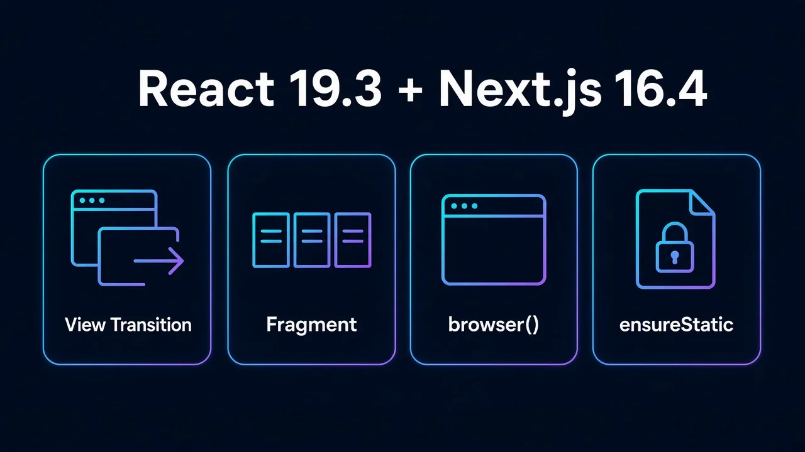





---

> 리스트 아이템이 생길 때 크로스페이드가 안 붙고, `typeof window`로 서버 렌더를 피하다 하이드레이션이 어긋나고, 블로그 페이지에 동적 컴포넌트 하나가 섞여 요청마다 서버가 도는 문제.
> React 19.3과 Next.js 16.4가 이 자리를 공식 API로 가져갔다.

{: #magnific width="1280" height="720"}

[React 19.2 & Next.js 16](/reactguide/2026/08/27/react-19-2-next-16/)에서 Activity, Compiler, `"use cache"`를 정리했다. 그 글의 View Transition은 아직 실험이었다. 2026년 9월 9일 React 19.3에서 안정이 됐고, Next.js 16.4에 그대로 들어간다.

참고: [React 19.3](https://react.dev/blog/2026/09/09/react-19-3), [`<ViewTransition>`](https://react.dev/reference/react/ViewTransition), [Next.js 16.4](https://nextjs.org/blog/next-16-4)

---

## 1. `<ViewTransition>` — Transition으로 표시된 업데이트만 움직인다

감싸기만 하면 모든 `setState`가 애니메이션되지는 않는다. **Transition으로 표시된 업데이트**만 탄다.

- `startTransition` / `useTransition`
- Suspense가 fallback에서 실제 콘텐츠로 바뀌는 순간
- `useDeferredValue`

급한 업데이트는 바로 화면에 반영하는 게 목적이라 애니메이션을 타지 않는다.

```tsx
import { ViewTransition, startTransition, useState } from "react";

function VideoRow() {
  const [open, setOpen] = useState(false);

  return (
    <>
      <button
        onClick={() => {
          startTransition(() => setOpen((v) => !v));
        }}
      >
        {open ? "접기" : "펼치기"}
      </button>
      {open && (
        <ViewTransition>
          <VideoCard />
        </ViewTransition>
      )}
    </>
  );
}
```

트리 변화에 따라 네 가지로 갈린다.

| 트리거   | 언제                                      |
| -------- | ----------------------------------------- |
| `enter`  | `<ViewTransition>`이 새로 붙을 때         |
| `exit`   | 제거될 때                                 |
| `update` | 안쪽 내용·크기·위치가 바뀔 때             |
| `share`  | 같은 `name`이 한곳에서 사라지고 다른 곳에 생길 때 |

기본은 브라우저 크로스페이드다. 클래스 이름을 주면 CSS로 바꾼다. `view-transition-name`으로 스타일을 거는 예전 예제 대신, React는 **클래스**를 권한다.

```tsx
<ViewTransition enter="slide-in" exit="slide-out">
  <VideoCard />
</ViewTransition>
```

```css
::view-transition-new(.slide-in) {
  animation: 300ms ease-out both slide-from-right;
}

::view-transition-old(.slide-out) {
  animation: 300ms ease-in both slide-to-left;
}

@keyframes slide-from-right {
  from {
    transform: translateX(100%);
  }
  to {
    transform: translateX(0);
  }
}

@keyframes slide-to-left {
  from {
    transform: translateX(0);
  }
  to {
    transform: translateX(-100%);
  }
}

@media (prefers-reduced-motion: reduce) {
  ::view-transition-old(*),
  ::view-transition-new(*) {
    animation: none;
  }
}
```

같은 상태 변화라도 방향이 다르면 `addTransitionType`으로 원인을 붙인다. 캐러셀에서 3번 슬라이드로 가는 길이 앞이냐 뒤냐에 따라 애니메이션이 달라져야 할 때다.

```tsx
import { addTransitionType, startTransition } from "react";

function next() {
  startTransition(() => {
    addTransitionType("next");
    setIndex((i) => i + 1);
  });
}

<ViewTransition
  enter={{ next: "from-right", previous: "from-left" }}
  exit={{ next: "to-left", previous: "to-right" }}
>
  <Slide />
</ViewTransition>;
```

Suspense와 같이 쓰면 fallback이 본문으로 바뀌는 순간에 애니메이션이 붙는다. `<ViewTransition>` 안의 ``와 `<style href>`는 로드가 끝날 때까지 Suspense로 남아서, 글자가 먼저 뜨고 이미지가 나중에 깜빡이는 순서를 맞출 수 있다.

```tsx
<ViewTransition>
  <Suspense fallback={<CardSkeleton />}>
    
  </Suspense>
</ViewTransition>
```

알아둘 것:

- `<>...</>` 단축 문법이 아니라 컴포넌트다. `react`에서 import 한다.
- DOM 전용이다. React Native는 아직이다.
- `name`은 공유 요소 전환에만 쓴다. 그 외에는 React가 이름을 만든다. 동시에 같은 `name`이 둘이면 안 된다.
- `enter`는 이번 Transition에서 그 `<ViewTransition>`이 새로 들어온 경계일 때 탄다. 같은 업데이트 안의 중첩 경계가 있으면 안쪽이 가져간다.
- `prefers-reduced-motion`을 React가 자동으로 끄지 않는다. CSS에서 끈다.
- React가 `startViewTransition`을 호출한다. 페이지에서 직접 호출하면 React 쪽 전환과 겹친다.

19.2 글에서 Activity로 상태를 남긴 채 화면을 바꾸고, View Transition으로 그 전환을 부드럽게 만든다고 적어 둔 그림이 이제 실험 플래그 없이 된다.

---

## 2. Fragment Refs — 감싸는 div 없이 형제 DOM을 다룬다

목록을 맵으로 그리면 부모가 하나인 DOM이 없다. 라이브러리 컴포넌트가 `ref`를 안 넘기면 관찰할 노드를 얻을 수 없다. `<div ref>`로 감싸면 레이아웃이 깨지는 경우가 있다.

19.3은 `<Fragment ref>`로 `FragmentInstance`를 준다. DOM 구조는 그대로 두고, 자식들을 한 덩어리로 다룬다.

```tsx
import { Fragment, useLayoutEffect, useRef } from "react";

function InView({
  onChange,
  children,
}: {
  onChange: (visible: boolean) => void;
  children: React.ReactNode;
}) {
  const fragmentRef = useRef<React.ComponentRef<typeof Fragment>>(null);

  useLayoutEffect(() => {
    const instance = fragmentRef.current;
    if (!instance) return;

    const visible = new Set<Element>();
    const observer = new IntersectionObserver((entries) => {
      for (const entry of entries) {
        if (entry.isIntersecting) visible.add(entry.target);
        else visible.delete(entry.target);
      }
      onChange(visible.size > 0);
    });

    instance.observeUsing(observer);
    return () => instance.unobserveUsing(observer);
  }, [onChange]);

  return <Fragment ref={fragmentRef}>{children}</Fragment>;
}
```

`<>`에는 `ref`를 줄 수 없다. `Fragment`를 써야 한다.

| 메서드 | 하는 일 |
| --- | --- |
| `addEventListener` / `removeEventListener` / `dispatchEvent` | 바로 아래 자식의 이벤트 |
| `focus` / `focusLast` / `blur` | 중첩 자식을 깊이 우선으로 포커스 |
| `observeUsing` / `unobserveUsing` | `IntersectionObserver`, `ResizeObserver` |
| `getClientRects` / `scrollIntoView` / `getRootNode` / `compareDocumentPosition` | 측정, 스크롤 |

`querySelector`처럼 노드를 마음대로 꺼내는 API는 아니다. 이벤트, 포커스, 관찰, 측정만 된다.

---

## 3. `browser()` — 서버에서 그리지 못할 컴포넌트

타임존, `localStorage`처럼 서버 HTML을 만들 수 없는 컴포넌트는 보통 이렇게 피했다.

```tsx
const [mounted, setMounted] = useState(false);
useEffect(() => setMounted(true), []);

const isBrowser = typeof window !== "undefined";
```

`mounted` 플래그는 한 박자 늦게 뜨고, `typeof window`는 서버와 클라이언트의 첫 렌더가 달라져 하이드레이션이 어긋난다.

`use(browser())`는 서버에서만 Suspense를 탄다. 클라이언트에서 하이드레이션된 뒤에는 suspend하지 않는다. 가장 가까운 Suspense fallback이 초기 HTML에 남는다.

```tsx
import { Suspense, use } from "react";
import { browser } from "react-dom";

function TimeZone() {
  use(browser());
  const timeZone = new Intl.DateTimeFormat().resolvedOptions().timeZone;
  return <p>{timeZone}</p>;
}

export function TimeZoneBlock() {
  return (
    <Suspense fallback={<p>시간대 불러오는 중</p>}>
      <TimeZone />
    </Suspense>
  );
}
```

`browser`는 `react-dom`에 있다. `use`는 `react`에 있다.

`use`라서 조건 뒤에서 호출할 수 있다. 서버가 넣어 준 기본값이 있으면 그대로 그리고, 없을 때만 브라우저로 미룬다.

```tsx
function TimeZone({ defaultValue }: { defaultValue?: string }) {
  if (defaultValue) return <p>{defaultValue}</p>;

  use(browser());
  const timeZone = new Intl.DateTimeFormat().resolvedOptions().timeZone;
  return <p>{timeZone}</p>;
}
```

React Query도 같은 패턴이다. `initialData`가 있으면 서버 HTML에 포함하고, 없으면 브라우저에서 가져온다.

```tsx
function useBrowserQuery(
  queryKey: string,
  options: { initialData?: { name: string } },
) {
  if (options.initialData === undefined) {
    use(browser());
  }

  return useQuery({ queryKey: [queryKey], initialData: options.initialData });
}
```

`use`는 다른 훅과 달리 조건문 뒤에서 호출할 수 있다. `use(browser())`도 그렇다. 그 외 `use`를 조건부로 잘못 쓰면 19.3이 경고한다.

---

## 4. Server Component에서 Context를 바로 렌더한다

Server Component는 Context를 **만들 수** 없다. 읽어서 클라이언트 트리에 넘기려면 `'use client'` 모듈의 Provider를 한 겹 더 만들었다.

19.3부터는 그 래퍼 없이, 클라이언트 모듈에서 export한 Context를 서버에서 바로 렌더한다.

```tsx
// user-context.tsx
"use client";

import { createContext } from "react";

export const UserContext = createContext<{ name: string } | null>(null);
```

```tsx
// layout.tsx — Server Component
import { UserContext } from "./user-context";

export default async function Layout({
  children,
}: {
  children: React.ReactNode;
}) {
  const currentUser = await getCurrentUser();

  return <UserContext value={currentUser}>{children}</UserContext>;
}
```

값을 그대로 넘기기만 하는 Provider는 지워도 된다. Context를 서버에서 `createContext`로 만드는 건 여전히 안 된다.

---

## 5. 올릴 때 같이 보는 변경

**Trusted Types.** `Content-Security-Policy: require-trusted-types-for 'script'`를 쓰는 사이트에서, React는 DOM에 넣기 전 값을 `'' + value`로 문자열화했다. `TrustedHTML`이 일반 문자열이 되어 브라우저가 거절했다. 19.3은 그 객체를 그대로 DOM API에 넘긴다. 이 CSP를 안 쓰면 체감은 없다.

**Transition은 서로 기다리지 않는다.** 느린 Transition 하나가 관계없는 Transition 렌더를 붙잡던 동작을 걷어냈다. Transition마다 따로 렌더한다.

**Strict Mode는 하이드레이션 중에도 Effect를 두 번 돌린다.** 개발 모드에서 클라이언트 루트와 맞춘 것이다. cleanup이 없는 Effect, 구독을 두 번 여는 Effect는 업그레이드 직후 개발 모드에서 먼저 보인다. 프로덕션에서 두 번 실행되지는 않는다.

**Activity 버그 수정.** hidden 트리 안에서 스토어 변경을 놓치던 `useSyncExternalStore`, hidden으로 바뀐 뒤에도 `<link>`가 `<head>`에 남던 경우, hidden Activity 밖으로 새던 에러가 고쳐졌다. 19.2 글의 Activity를 이미 쓰고 있다면 19.3이 그 구멍에 해당한다.

---

## 6. Next.js 16.4 — Cache Components가 권장 모델이 됐다

16.x에서 `"use cache"`로 컴포넌트 일부를 캐시하는 모델을 넣어 왔고, 16.4부터 **모든 앱에 권장**이다. `create-next-app`으로 만든 새 앱은 켜진 채로 시작한다. Next.js 17에서는 기본값이 된다.

이전 App Router의 암묵적 캐시 대신, 캐시할 구간을 코드에 적는다. 16.2까지의 `"use cache"` + `cacheLife`는 [19.2 글](/reactguide/2026/08/27/react-19-2-next-16/)에 있다. 16.4에서 새로 막힌 구멍은 두 개다. 정적 페이지가 조용히 동적 렌더로 떨어지는 것, prefetch가 사용자가 안 열 데이터까지 가져가는 것이다.

모델은 플래그 두 개다. Partial Prefetching이 이제 모델의 일부다.

```ts
import type { NextConfig } from "next";

const nextConfig: NextConfig = {
  cacheComponents: true,
  partialPrefetching: true,
};

export default nextConfig;
```

### `ensureStatic` — 동적 컴포넌트가 섞이면 빌드가 실패한다

아바타만 요청 시점에 그리고, 본문은 `'use cache'`로 미리 그리는 구성은 그대로 가능하다. 블로그·마케팅·커머스처럼 **이 라우트는 절대 요청 시점 렌더가 되면 안 되는** 곳에는 라우트(또는 레이아웃)에 선언을 둔다.

```tsx
export const ensureStatic = "navigation";

export default function Page() {
  return (
    <>
      <UserAvatar /> {/* 요청 시점 컴포넌트면 빌드 실패 */}
      <Content />
    </>
  );
}
```

| 값            | 보장                                              |
| ------------- | ------------------------------------------------- |
| `navigation`  | 내비게이션 전체가 정적. 동적 조각이 있으면 빌드 실패 |
| `prefetch`    | `prefetch`를 명시한 링크가 정적 콘텐츠만 가져감   |
| `shell`       | 라우트를 처음 발견할 때 정적 껍데기만 가져감      |

루트 레이아웃에 `navigation`을 두면 사이트 전체가 정적 내비게이션이다. 일부 페이지만 동적이면 그 구간 레이아웃에서 선언을 내린다.

### `navigation()` — prefetch에서 빼고, 클릭 때 가져온다

받은편지함 링크마다 `prefetch`를 주면 스레드 전체가 뷰포트에 들어올 때 로드된다. 안 읽는 메일까지 서버를 친다.

`await navigation()` 뒤에서 그린 캐시 콘텐츠는 prefetch에 포함되지 않는다. 실제 이동 때 불러온다.

```tsx
import { navigation } from "next/cache";
import { Suspense } from "react";

async function Message({ id }: { id: string }) {
  const message = await getMessage(id);

  return (
    <>
      <h1>{message.subject}</h1>
      <Suspense fallback={<p>스레드 불러오는 중</p>}>
        <Thread id={id} />
      </Suspense>
    </>
  );
}

async function Thread({ id }: { id: string }) {
  await navigation();
  const thread = await getThread(id);
  return thread.map((item) => <p key={item.id}>{item.body}</p>);
}
```

`await prefetch()`는 반대 방향이다. 라우트 껍데기에서는 빼고, `<Link prefetch>`나 `router.prefetch()`가 있을 때만 포함한다.

---

## 7. 에이전트 업그레이드와 번들

**업그레이드.** `npx next@canary upgrade --agent=latest`는 설치된 버전을 보고, 대상 릴리스의 가이드·코드모드·검증 단계를 에이전트에 넘긴다. 앱이 옛 버전이어도 `next@canary`의 업그레이드 도구를 쓴다.

`next dev` / `next build` 중 알림은 `experimental.agentUpgrade`다.

| 값          | 동작                                      |
| ----------- | ----------------------------------------- |
| `'security'` | 기본. 설치된 버전에 해당하는 보안 업데이트 |
| `'latest'`   | 메이저·마이너 새 릴리스도 알림            |
| `false`      | 끔                                        |

Cache Components로 옮기는 작업은 이 플래그만으로 끝나지 않는다. 스킬로 프리렌더가 안 되는 라우트부터 찾으면 된다.

```bash
npx skills add vercel/next.js --skill next-cache-components-adoption
```

**번들.** 16.4 Bundle Analyzer는 큰 라우트 요약, 크기순 테이블, 스냅숏 diff, 초기 렌더 경로에서 async 의존성을 빼는 필터가 생겼다. 에이전트 스킬은 Turbopack 모듈 그래프를 열어, `React.lazy`로 미뤄 둔 파일이 같은 청크의 정적 import에 끌려 처음부터 실리는 경우를 찾는다.

```bash
npx skills add vercel/next.js --skill next-bundle-optimizer
```

앱을 16.4로 올린 뒤 에이전트에서 `/next-bundle-optimizer`를 실행한다. 고치기 전에 스냅숏 diff로 줄어든 크기를 확인한다.

**피드백.** `experimental.agentFeedback: true`면 에이전트가 프레임워크 이슈 초안을 만들고 브라우저에서 검토하게 한다. 소스, 로그, 시크릿은 빼라고 지시되어 있고, Send를 누르기 전에는 전송되지 않는다. 텔레메트리가 켜져 있어야 하고 CI에서는 돌지 않는다. 새 `create-next-app` 권장 설정은 기본으로 켜진다.

---

## 8. 설정 없이 줄어드는 것, 실험으로 켜는 것

모든 16.4 앱에 적용된다.

- Turbopack 디스크 캐시가 20~25% 줄었다. 큰 데이터는 Zstandard, 메타데이터는 LZ4다.
- 서버 HMR은 요청이 온 라우트만 다시 컴파일한다. 예전에 방문한 페이지를 백그라운드에서 같이 갱신하지 않는다.
- 런타임 청크를 라우트끼리 공유한다.
- 프로덕션 CSS Module 클래스 이름이 짧아진다. 개발 빌드는 디버깅용으로 긴 이름을 유지한다.
- 모듈을 잇는 export 이름도 줄인다.
- React 19.3이 포함된다.

실험 플래그는 필요한 것만 켠다.

```ts
const nextConfig = {
  reactCompiler: true,
  experimental: {
    turbopackRustReactCompiler: true,
    turbopackGc: true,
    turbopackLazyDynamicImports: true,
  },
};
```

Rust React Compiler는 16.3에 들어왔고, 16.4는 최적화할 필요 없는 파일을 건너뛴다. 서버 렌더용 Client Component에 같은 최적화를 반복하지 않는다. Turbopack 쪽 메모리 할당 변경으로 컴파일러 메모리가 약 30%, 컴파일 시간이 약 15% 줄었다고 한다. `turbopackGc`는 긴 dev 세션에서 안 쓰는 컴파일 결과를 메모리와 디스크에서 지운다. `turbopackLazyDynamicImports`는 `import()`를 브라우저가 요청할 때 컴파일한다. `next/dynamic` 일부는 여전히 미리 컴파일된다.

---

## 한 줄로 정리

| 문제 | 지금 쓸 것 |
| --- | --- |
| 나타나고 사라지는 UI를 크로스페이드 | `<ViewTransition>` + `startTransition` |
| 방향마다 다른 애니메이션 | `addTransitionType` |
| 래퍼 div 없이 형제 노드 관찰 | `<Fragment ref>` |
| 타임존·`localStorage`를 서버에서 그리기 | `use(browser())` + Suspense |
| 값만 넘기는 Client Provider | Server Component에서 `<Context value>` |
| Trusted Types CSP에서 React가 문자열로 바꿈 | 19.3 |
| 개발 하이드레이션에서 Effect가 한 번만 도는지 확인 | Strict Mode가 이제 두 번 돌림. cleanup 점검 |
| 정적 라우트에 동적 컴포넌트가 섞임 | `ensureStatic = "navigation"` |
| prefetch가 안 읽는 데이터까지 가져감 | `await navigation()` |
| 에이전트가 구버전 Next로 업그레이드 | `npx next@canary upgrade --agent=latest` |
| lazy가 정적 import에 끌려 초기 번들에 포함 | `next-bundle-optimizer` |

19.2가 “무엇을 캐시하고 어떤 Effect가 구독인지”를 코드로 드러냈다면, 19.3과 16.4는 **그 캐시가 정적 페이지를 조용히 동적으로 바꾸지 않게** 하고, 화면 전환은 Transition 경계 안에서만 움직이게 한다.


